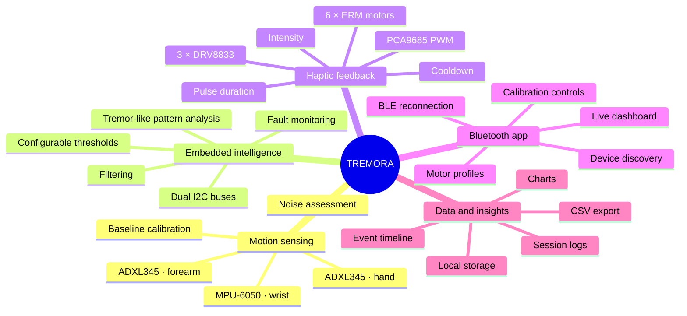
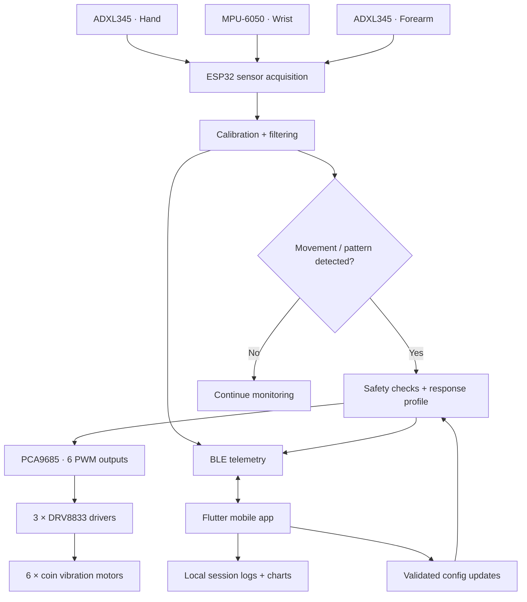
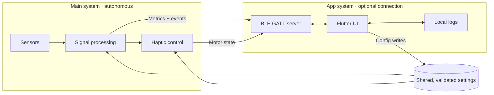
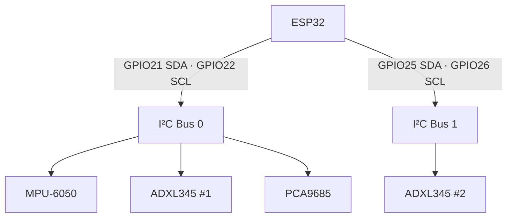
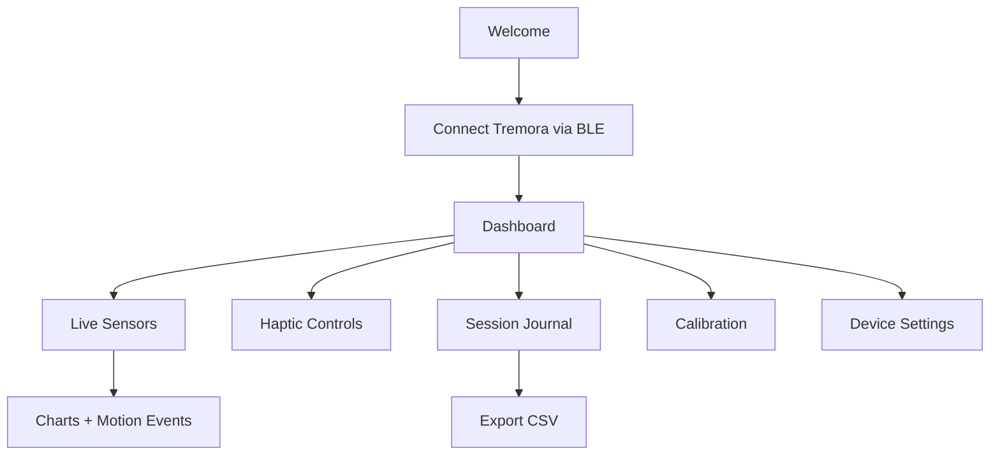
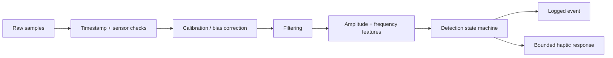

<div align="center">

# ✦ T R E M O R A ✦

### An intelligent, Bluetooth-connected haptic glove prototype

**Sense movement · Analyze patterns · Explore responsive haptics**

[](#-development-roadmap)
[](#-hardware-stack)
[](#-companion-app)
[](#-project-status)

*An experimental wearable platform for studying hand and forearm motion and exploring configurable vibrotactile feedback.*

</div>

---

> [!IMPORTANT]
> **Research prototype — not a medical device.** Tremora is not a validated Parkinson's diagnostic or treatment system. Its movement-detection and haptic-response features are experimental. Test electronics off-body; any human evaluation requires appropriate adult and clinical supervision.

## ✨ The vision

**Tremora** combines distributed motion sensing, onboard signal processing, six independently addressable vibration outputs, and a Bluetooth companion app. The core logic runs on the ESP32 even when no phone is connected; the app acts as a control panel, visualizer, and session journal.

<table>
<tr><td align="center"><b>03</b><br/>Motion sensors</td><td align="center"><b>06</b><br/>Haptic motors</td><td align="center"><b>02</b><br/>I²C buses</td><td align="center"><b>01</b><br/>BLE companion app</td></tr>
</table>

## 🧠 System mind map



## ⚙️ How it works



### Two systems, one ESP32



> **Design rule:** A lost phone connection must not interrupt sensor sampling. The motor controller must have its own safe-off behavior, irrespective of BLE state.

## 🧩 Hardware stack

| Component | Quantity | Role |
|---|---:|---|
| ESP32 | 1 | Acquisition, processing, haptic control, BLE |
| ADXL345 | 2 | Motion acceleration at hand and forearm |
| MPU-6050 | 1 | Acceleration + angular velocity near wrist |
| PCA9685 | 1 | Six PWM control signals |
| DRV8833 dual H-bridge | 3 | Power switching for six motors |
| 10 mm ERM coin motor | 6 | Vibrotactile outputs |
| LM2596 buck converter | 1 | Regulated motor supply, subject to load verification |
| External DC source | 1 | Separate motor power |

### Sensor placement

```text
FINGERS ── [ ADXL345 #1 · BACK OF HAND ]
                     │
                 [ MPU-6050 ]
                   WRIST
                     │
             [ ADXL345 #2 ]
                  FOREARM
```

### I²C topology (working prototype configuration)



The second ADXL345 has its own I²C bus, allowing two modules with the same address to operate independently. The PCA9685 controls motor-driver inputs, **not motors directly**.

## 📱 Companion app

**Planned stack:** Flutter · Dart · Bluetooth Low Energy · local SQLite storage · interactive charts

| Screen | Experience |
|---|---|
| **Home / Live** | Connection health, movement state, current haptic profile |
| **Sensor Studio** | Live accelerometer/gyroscope graphs and per-sensor diagnostics |
| **Calibration Lab** | Stationary baselines, configurable detection parameters, save/reset |
| **Haptic Mixer** | Per-motor intensity, group presets, pulse duration, safe disable |
| **Session Journal** | Time-stamped detections, notes, session history |
| **Insights** | Trend views, movement summaries, comparison across sessions |
| **Device Center** | BLE pairing, reconnect, firmware version, sensor fault indicators |
| **Export** | CSV logs for Python/MATLAB analysis |

### App navigation



## 📡 Bluetooth protocol

**ESP32:** BLE GATT peripheral/server · **Phone:** BLE central/client

| GATT characteristic | Direction | Payload concept |
|---|---|---|
| `telemetry` | ESP32 → App | Sample time, per-sensor motion metrics |
| `detection_event` | ESP32 → App | Detection flag, confidence/quality, event time |
| `motor_status` | ESP32 → App | Output enabled, active profile, fault status |
| `configuration` | App → ESP32 | Thresholds, filter settings, duration, PWM bounds |
| `control` | App → ESP32 | Stop/disable, start or end recording |
| `device_info` | ESP32 → App | Firmware version, sensor health, capabilities |

> UUIDs, packet layouts, update rates, reconnect behavior, and settings persistence will be specified and versioned during BLE implementation. The app must validate user input and the ESP32 must independently enforce safety bounds.

## 🧪 Signal processing roadmap



- **Stage A — Characterize:** Measure stationary noise and ordinary voluntary movement; record raw data for offline analysis.
- **Stage B — Explore:** Assess repetitive oscillation frequency, amplitude, and stability. A frequency band alone does not diagnose Parkinsonian tremor.
- **Stage C — Tune:** Choose thresholds from data and evaluate false positives and missed detections.
- **Stage D — Respond:** Configure duty cycle, maximum-on duration, rearm/cooldown, and manual disable.
- **Stage E — Validate:** Compare recorded predictions with independent reference observations; do not infer therapeutic effect from motor activation.

## 📊 Logging and analytics

**Planned local-first records**

```text
sessions/
  2026-10-23_001/
    session.json            # Start/end time, firmware, config
    sensor_samples.csv      # Timestamped sensor measurements
    motion_events.csv       # Detection transitions and features
    motor_events.csv        # On/off, channel profile, duty cycle
    diagnostics.json        # Sensor faults, reconnects, resets
```

**Example CSV schema** (illustrative, not collected data):

```csv
timestamp_ms,hand_motion_g,wrist_rotation_dps,forearm_motion_g,detected,motors_enabled
1200,0.014,0.6,0.012,0,0
1400,0.121,3.1,0.081,0,0
```

### Insight cards (planned)

- Active monitoring time
- Detection-event count and duration
- Motion amplitude distributions
- Frequency estimates with signal-quality indicators
- Motor activation count and cumulative on-time
- Sensor error rate and BLE reconnect history

## 🛡️ Safety by design

- Default motor outputs **OFF** on startup, firmware fault, or missing sensor.
- Keep hard limits on vibration duty cycle and activation duration.
- Use an independent physical power disconnect; app controls are not a substitute.
- Verify motor voltage/current and external-supply capacity before powered testing.
- Keep motor power separate from logic power, with verified polarity and a shared signal-ground reference.
- Perform initial testing **off-body**; avoid using full-power vibration during calibration.
- Treat detections as **experimental motion metrics**, not clinical diagnoses.

## 🗺️ Development roadmap

| Milestone | Status |
|---|---|
| ESP32 firmware uploading via PlatformIO | ✅ Tested |
| MPU-6050 + dual ADXL345 communication | ✅ Tested |
| PCA9685 I²C communication | ✅ Tested |
| Basic movement-triggered output prototype | 🟡 Implemented; validation pending |
| Sensor data collection and noise profiling | ⬜ Planned |
| Tremor-like pattern analysis | ⬜ Planned |
| Bounded motor response profiles | ⬜ Planned |
| BLE GATT service and protocol | ⬜ Planned |
| Flutter UI/UX | ⬜ Planned |
| Live dashboards and local logs | ⬜ Planned |
| End-to-end testing and independent validation | ⬜ Planned |


<div align="center">

### TREMORA

*Built to explore how sensing, embedded intelligence, and haptic interaction can work together.*

**Prototype • Open to iteration • Evidence first**

</div>
